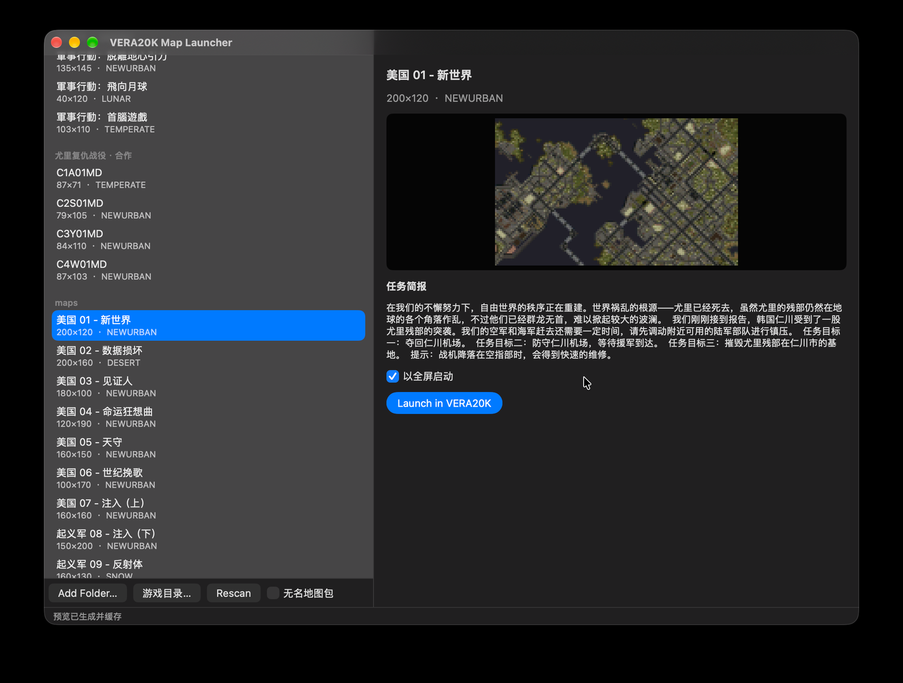

# VERA20K Launcher

A small macOS map launcher for [VERA20K](https://github.com/YuriPlanet/vera20k), the
Rust rewrite of *Command & Conquer: Red Alert 2 — Yuri's Revenge*.

It browses **every campaign chapter (original Red Alert 2 and Yuri's Revenge) and
any custom map**, shows the mission briefing, renders a real map preview, and
starts the game straight from the list.



> Selecting a Yuri's Revenge chapter: mission title, briefing text and the
> engine-rendered map preview, with one-click launch.

[中文说明](#中文说明)

---

## What it does

- **Lists the original Red Alert 2 campaigns.** The RA2 install keeps each
  chapter's identity inside the map (`[Basic] Briefing=Brief:ALL01`,
  `NextScenario=…`), so the launcher names them from `ra2.csf` — Allied 12
  chapters, Soviet 10 — and orders them by mission number.
- **Lists Yuri's Revenge chapters**, split into Allied / Soviet / co-op, named
  from the YR `MISSIONMD.INI` + `ra2md.csf` tables.
- **Lists custom maps** from any folder you add, plus maps packed inside retail
  MIX archives (`mapsmd03.mix`, `multimd.mix`).
- **Mission text**: title and briefing for the selected chapter, from the table
  that belongs to that chapter's origin (RA2 → `ra2.csf`, YR → `ra2md.csf`,
  a mod → the mod's own tables).
- **Real map previews.** Campaign maps ship no `[PreviewPack]`; the launcher asks
  the engine to dump the radar terrain surface it builds for the in-game minimap
  (whole map, CPU-generated, shroud-free) and caches it as a PNG.
- **Launch** writes a `spawn.ini` and starts the game with `-SPAWN`; campaign vs
  skirmish is decided from the map's own name, so there is no mode or side picker.
  A fullscreen toggle is included.

## Requirements

1. **macOS 13 or newer** on Apple silicon.
2. A **[VERA20K](https://github.com/YuriPlanet/vera20k) checkout** with its
   `map-tool` built:
   ```sh
   cargo build --release --locked -p vera20k --bin map-tool
   ```
   Every archive lookup, mission table read, preview render and launch runs
   through that binary — this project holds no duplicate parser.
3. **Retail game data**: your own *Red Alert 2* and/or *Yuri's Revenge* install.
   No game files are included or redistributed.

## Quick start

```sh
git clone https://github.com/yeungtuzi/vera20k-launcher.git
cd vera20k-launcher

# 1. Build the map library from your installs (one time, re-run when they change)
VERA20K_ROOT=/path/to/vera20k bash prepare_library.sh \
    --yr  "/path/to/Yuris Revenge" \
    --ra2 "/path/to/Red Alert 2" \
    --mod "/path/to/map-or-mod-folder"      # optional

# 2. Build and install the app
VERA20K_ROOT=/path/to/vera20k bash build.sh
```

`build.sh` installs `VERA20K Launcher.app` into `/Applications` (pass a directory to
change that). Without `VERA20K_ROOT` it looks for `../vera20k`.

### Example: a mod pack that ships its own text and rules

Overlay packs (a Chinese campaign pack, for instance) ship replacement
`ra2md.csf`, `rulesmd.ini`, `artmd.ini`, an `expandmdNN.mix` and their own `*.map`
files. Passing that folder as `--mod` does three things:

```sh
VERA20K_ROOT=/path/to/vera20k bash prepare_library.sh \
    --yr  "/path/to/Yuris Revenge" \
    --ra2 "/path/to/Red Alert 2" \
    --mod "/path/to/lindlark3"          # the pack's folder
```

1. builds `base-mod/` — the YR clone plus the pack's files overriding them **by
   name**, so `rulesmd.ini` and `ra2md.csf` come from the pack while everything
   else still comes from your install;
2. copies the pack's `*.map` files into `maps/` so they appear as a group;
3. points the engine's `ra2_dir` at `base-mod/`, which is what removes the
   `MISSING:'<key>'` placeholders in that pack's in-game messages.

Your install is never modified: the overlay lives entirely in the library. Re-run
the script whenever the game or the pack changes.

## The map library

`prepare_library.sh` builds everything the launcher reads under
`~/Library/Application Support/VERA20K-Maps/`:

| Path | Contents |
|---|---|
| `base/` | APFS clone of the YR install — shares blocks with the source, ~no extra space |
| `base-mod/` | the clone plus a mod pack's files on top (when `--mod` is given) |
| `meta-base/` | `MISSIONMD.INI` + `ra2md.csf` from the YR install |
| `meta-ra2/` | `ra2.csf` from the Red Alert 2 install |
| `meta/` | the mod's mission table and CSF |
| `campaign/` | YR chapters, extracted by retail file name |
| `ra2-campaign/` | RA2 chapters, extracted by MIX entry id |
| `packs/` | retail map packs for the "packed" section |
| `previews/` | cached map previews written by the launcher |

Keeping the library outside `~/Downloads` matters: macOS blocks the first access
to protected folders until a human approves it, which hangs any process that
tries.

`prepare_library.sh` also points the engine at `base-mod/` (or `base/`) by writing
`ra2_dir` into the game's `config.toml`, so mod text and rules resolve without
copying files into your install.

## How it works

The window is only a browser. Each action shells out to `map-tool`:

| Launcher action | Command |
|---|---|
| scan folders | `map-tool list <dirs> --mission-ini … --csf …` |
| scan map packs | `map-tool mix <pack>` |
| mission title/briefing | `map-tool info <map> …` |
| packed thumbnail | `map-tool preview <map> --out png` |
| real map preview | `map-tool radar-preview <map> --out png` |
| start a chapter | `map-tool launch <map> …` |

`radar-preview` starts the map once with `RA2_DUMP_RADAR=<path>`; the engine writes
the radar terrain surface (the in-game minimap source) and the launcher stops the
game. No reveal cheats and no screenshot stitching are involved. The cost is one
game launch per map, which is why previews are cached.

Each launch gets a private directory under `VERA20K-Maps/…/runs/<hash>/` holding
its own `spawn.ini` and a copy of the map, and two process-scoped overrides keep
it isolated:

| Variable | Effect |
|---|---|
| `RA2_DIR` | overrides `paths.ra2_dir` for that process only |
| `RA2_SPAWN_INI` | names the launch file `-SPAWN` should read |

No shared file is rewritten, so a direct launch (or the retail app) always sees
the pristine install, and a campaign pack that reuses `all01umd.map` can no
longer shadow the official chapter of the same name.

## Ordering and naming

1. Original Red Alert 2 chapters (Allied, then Soviet), by mission number.
2. Yuri's Revenge chapters (Allied, Soviet, co-op).
3. Folders and map packs you add, newest folder last.

Maps are deduplicated by mission id: retail ships each chapter twice (in
`Maps01.mix` and `Maps02.mix`). Pack entries with no name are hidden behind the
"unnamed packs" checkbox, because retail stores them under hash ids only.

## Known limits

- Preview generation takes 20–40 s and briefly opens the game window.
- Packed maps have no names in retail data; the launcher shows `map #<id>` for
  them unless the pack is a named custom one.
- The training chapters are hidden: all nine maps carry the same `Brief:TRN01`
  key, so they cannot be told apart.
- Save games record the scenario name, so a save from a custom map needs that
  map on disk when you load it.
- Windows and Linux would need their own window layer; this app is macOS only.

## Notes for the engine upstream

This launcher is deliberately external: it parses the same data the game does and
never forks the renderer. Three observations from building it that may be useful
to VERA20K itself:

1. **Browsing maps needs no engine change.** Map lists, mission titles, briefings,
   previews and launches can all be produced from the existing data by a tool that
   loads `MapFile` and reads the MIX archives.
2. **A map without `[PreviewPack]` already has a free preview.** The engine builds
   a whole-map, CPU-side, shroud-free radar terrain buffer for the in-game
   minimap; dumping that buffer once as a PNG is a real preview. No reveal cheat,
   no screenshot stitching.
3. **Per-process overrides are what make external tooling safe.** The launch file
   is read from the working directory and the asset root from shared config, so a
   tool either mutates shared state or copies files into the game data directory.
   Two process-scoped overrides — asset root and launch-file path — remove both
   needs: `config.toml` stays untouched and a direct launch always sees the
   pristine install.

Pitfalls found the hard way, worth knowing before writing such a tool:

| Symptom | Cause |
|---|---|
| Official chapters show a mod's text | the mod overlay's `ra2md.csf` replaces the official mission text too |
| A third-party map shadows the official one | the pack reuses `all01umd.map`; a staged copy in the data directory wins |
| Save games fail with a TMP/variant error | the save records the scenario name but not the asset root; the wrong root or a shadowed map makes the terrain variant sets disagree, and the error names unrelated numbers |

In one line: a map launcher does not need the engine's asset system rewritten, it
needs the engine to allow naming the asset root and the launch file per process.
Everything else belongs to the tool.

## License

GPL-3.0, matching VERA20K — see [LICENSE](LICENSE). The app icon is composed from
the VERA20K project icon (GPL-3.0). *Command & Conquer*, *Red Alert 2* and
*Yuri's Revenge* are trademarks of Electronic Arts; this project is not affiliated
with or endorsed by EA.

---

## 中文说明

macOS 上的 **VERA20K 地图启动器**：浏览原版红警 2 与尤里复仇的**全部战役关卡**和任意
自定义地图，显示任务简报、渲染真实地图预览，并可一键开局。

### 功能

- **原版红警 2 战役**：RA2 的地图自带 `[Basic] Briefing=Brief:ALL01`、`NextScenario=…`，
  启动器据此从 `ra2.csf` 取名并按关卡编号排序（盟军 12 关、苏军 10 关）。
- **尤里复仇战役**：按盟军 / 苏军 / 合作分组，名称来自 YR 的 `MISSIONMD.INI` + `ra2md.csf`。
- **自定义地图**：任意文件夹，以及零售 MIX 包（`mapsmd03.mix`、`multimd.mix`）内的地图。
- **任务文本**：按关卡来源选择对应字符串表（RA2 → `ra2.csf`，YR → `ra2md.csf`，mod → 自己的表）。
- **真实预览**：战役图没有 `[PreviewPack]`；启动器让引擎导出它给小地图用的雷达地形缓冲
  （整图、CPU 生成、无迷雾）并缓存成 PNG。
- **启动**：写 `spawn.ini` 后用 `-SPAWN` 拉起游戏；战役/遭遇战由地图文件名自动判定，
  不需要选模式或阵营，另有全屏开关。

### 使用

```sh
VERA20K_ROOT=/path/to/vera20k bash prepare_library.sh \
    --yr "/path/to/尤里的复仇" --ra2 "/path/to/红警2" --mod "/path/to/地图或mod目录"
VERA20K_ROOT=/path/to/vera20k bash build.sh
```

需要：macOS 13+（Apple silicon）、已编译 `map-tool` 的 vera20k 检出、你自己的正版游戏文件
（本仓库不含任何游戏资源）。

### 说明

- 预览生成会启动一次游戏，约 20–40 秒，之后走缓存。
- 包内地图在零售数据里没有名字（只有哈希 id），默认隐藏。
- 训练关九张图共用同一个 `Brief:TRN01` 键，无法区分，已隐藏。
- 许可证 GPL-3.0，与 VERA20K 一致。

### 给引擎上游的说明

启动器刻意做在引擎外面：读同一份数据，不抄渲染。三条可能有用的结论：

1. **浏览地图不需要改引擎**：地图清单、任务名、简报、预览、启动，都能用外部工具读 `MapFile` 与 MIX 完成。
2. **没有 `[PreviewPack]` 的地图自带预览来源**：引擎为小地图生成的全图、CPU 侧、无迷雾雷达地形缓冲，导出一次 PNG 就是真实预览（不用 reveal，不用截图拼接）。
3. **进程级覆盖是外部工具安全的前提**：启动文件从工作目录读、资源根从共享配置读，外部工具只能改共享状态或往数据目录塞文件；给「资源根」和「启动文件路径」两个只对本进程生效的覆盖，这两个需求都消失，`config.toml` 不再被改写。

踩过的坑：mod 覆盖包的 `ra2md.csf` 会连官方关卡文本一起换；第三方包复用 `all01umd.map` 会顶掉官方地图；存档只记场景名不记资源根，根/地图错配时报的是 TMP 变体号，看起来毫不相关。

一句话：地图启动器不需要引擎重写资源系统，只需要引擎允许**按进程指定资源根与启动文件**，其余都属于工具。
